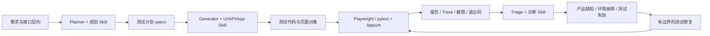

# Agent + Skill 自动化测试架构与设计说明

本文说明工程设计、模块职责与扩展方向。首次使用请从[项目总览](../readme.md)进入，按对应子工程指南完成环境准备与测试运行。

项目提供两个可逐步接入真实业务的测试工程。Web/API 自带本地待办服务；App 提供 Android/iOS 驱动适配和设备外框架验证。实际设备兼容性与业务流程需在目标环境验证。

| 项目 | 技术栈 | 入口 |
|---|---|---|
| Web UI + 接口 | Playwright Test、TypeScript、Zod、HTML/JUnit/Trace | [操作指南](../web-api-agent-tests/README.md) |
| Android / iOS | Appium 3、UiAutomator2/XCUITest、pytest、Page Object | [操作指南](../mobile-agent-tests/README.md) |
| Agent 工作流 | Codex CLI、仓库级 Skills、分阶段任务、独立回归 | [详细原理与实操](AGENT-WORKFLOW.md) |
| 验证记录 | 本次实际命令与范围 | [验证记录](VALIDATION.md) |

## 1. 这套方案怎样工作

传统自动化由人分析需求、找定位器、写用例，再交给测试引擎执行。这里把规划、生成和诊断交给编码 Agent，测试引擎仍负责浏览器、设备、接口调用与断言。

**Agent** 是能读取仓库、调用工具、修改代码和依据执行结果继续工作的模型运行时。本项目复用 Codex CLI 的工具循环，由其提供模型推理与工具调用能力；仓库中的 Python 调用器负责阶段派发、任务记录和外部验证。

**Skill** 是有 `name`、`description` 和具体工作规则的 `SKILL.md`，按任务发现并加载。这里 Skills 存在每个工程的 `.agents/skills/` 中，随代码版本管理。它们告诉 Agent 使用哪些 fixture、在哪里找契约、怎样采集定位证据、运行什么命令、如何界定修复范围。

**测试框架** 则提供可复现、可在 CI 中运行的代码和断言。已提交的测试平时无需调用模型；需要新增或维护时再调用 Agent，减少模型成本与运行结果波动。



图中是角色分工，不表示同时启动多模型。调用器每次执行一个阶段，便于审查计划、代码和证据；生成/修复完成后自动执行确定性验证。

## 2. 为什么选择这些工具

Playwright 官方提供 planner、generator、healer 测试 Agent，以及面向编码 Agent 的 CLI Skills，可直接复用生态。本工程在其测试引擎上增加 API 契约、数据隔离和仓库约定；也保留官方 Agent 定义的初始化入口。

Appium 负责跨平台原生 App 自动化，Android 与 iOS 分别使用 UiAutomator2、XCUITest。移动端由自定义 Skill 指导 Agent 调用 Appium 脚本和 pytest，复用相同的计划、生成、执行和诊断流程。

技术选型优先考虑执行能力、官方工具支持与团队维护成本。浏览器与原生 App 使用各自的执行引擎，Agent 约定和验证记录在工程层统一管理。

## 3. 目录导航

```text
QA-Automation/
├── web-api-agent-tests/
│   ├── .agents/skills/       # Web 规划、UI、API、失败诊断
│   ├── demo/                # 本地页面和真实 HTTP 服务
│   ├── src/api/             # API 客户端和 Zod 契约
│   ├── src/pages/           # Page Object
│   ├── tests/api/           # 接口用例
│   ├── tests/ui/            # UI 用例和 Agent seed
│   ├── tests/fixtures.ts    # 独立租户、上下文、清理
│   ├── specs/               # 可供 Agent 消费的测试计划
│   └── playwright.config.ts
├── mobile-agent-tests/
│   ├── .agents/skills/       # App 规划、生成、失败诊断
│   ├── config/              # Android / iOS W3C capabilities
│   ├── framework/           # 配置与 Driver 工厂
│   ├── pages/               # BasePage、LoginPage
│   ├── tests/unit/          # 不依赖设备的框架验证
│   ├── tests/device/        # 真实设备启动烟测
│   ├── tests/business/      # 需要真实 App 的登录示例
│   └── scripts/inspect_app.py
├── tools/agent_runner.py     # Codex 调用、任务记录、独立验证
├── tools/test_agent_runner.py
└── .github/workflows/qa.yml  # Web/API + App框架检查
```

## 4. 落地顺序

1. 先运行 Web/API 自带示例，熟悉报告、Trace、数据隔离和断言。
2. 将真实业务的测试环境、契约、页面入口接入。优先覆盖少量稳定核心流程。
3. 用 Skill 让 Agent 按计划扩展覆盖，人工检查首次生成的代码差异。
4. 为移动端准备模拟器与安装包，先验证启动，再接入真实登录页。
5. 把确定性回归放入 CI；失败诊断按需调用 Agent，修复保留证据。

## 5. 工程边界与扩展

演示服务使用内存数据，无身份认证、持久化和生产级限流；`x-test-tenant` 是示例隔离机制。真实项目需要测试账号、数据库隔离或可靠的创建/清理接口，不能照搬租户头当作权限方案。

当前默认验证 Chromium；Firefox/WebKit、多设备矩阵、视觉回归、性能测试、云真机与 Allure 可以按实际需求扩展，尚未实现。接口示例没有覆盖生产鉴权；`API_TOKEN` 仅提供传递真实测试 token 的接入点。

业务 App 登录是可接入的实现示例，账号和 accessibility ID 必须来自实际 App。默认 App 测试只打开系统设置验证会话与应用前台，不能等同于业务流程覆盖。

依赖版本见 `package-lock.json` 和 `requirements.txt`。Appium 平台驱动需要另行安装并记录版本。Node 依赖用 `npm ci` 重现；Python 直接依赖固定，全部解析结果另存于验证时生成的 `requirements-lock.txt`。升级需按官方兼容矩阵运行回归。

## 6. 官方资料

资料核验日期：2026-11-08。

- [Playwright Test Agents](https://playwright.dev/docs/test-agents)：官方三角色流程与初始化。
- [Playwright CLI Skills](https://playwright.dev/agent-cli/skills)：CLI Skill 安装和作用。
- [Codex Skills](https://learn.chatgpt.com/docs/build-skills)：Skill 的结构与工作方式。
- [Codex 非交互模式](https://learn.chatgpt.com/docs/non-interactive-mode)：脚本化执行、JSON 事件和输出文件。
- [Appium 安装](https://appium.io/docs/en/latest/quickstart/install/) 与 [驱动列表](https://appium.io/docs/en/latest/ecosystem/drivers/)：服务端与平台驱动独立安装。
- [Appium Python Client](https://github.com/appium/python-client)：W3C Options 与 Selenium 兼容关系。
